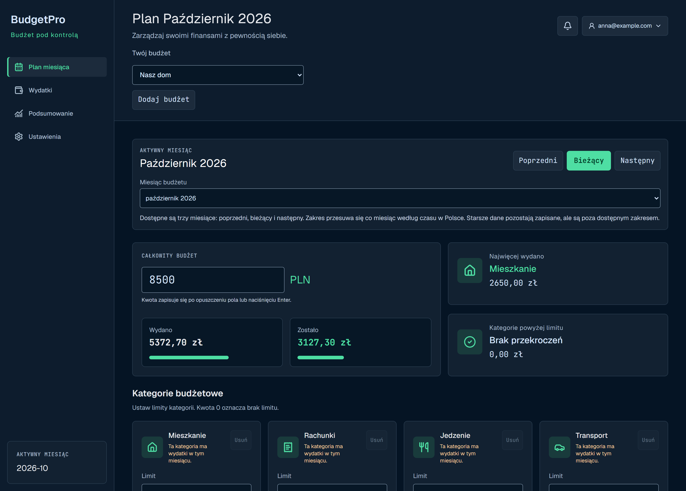
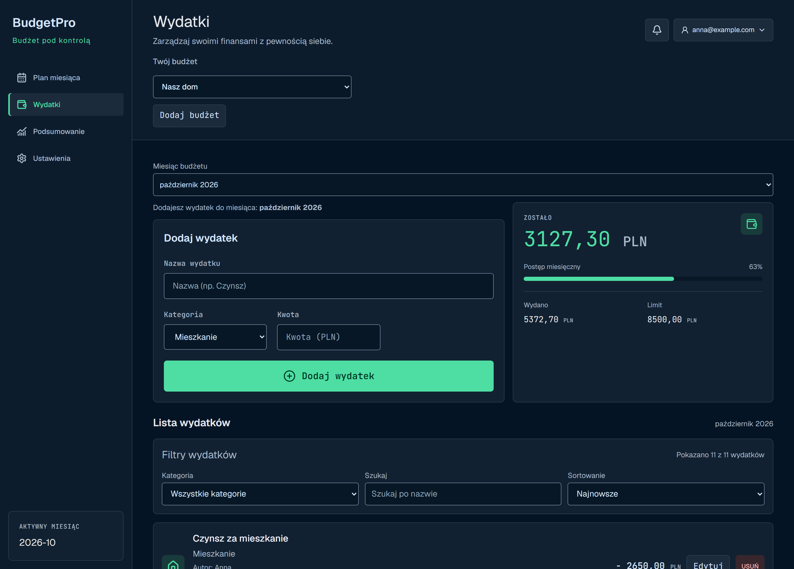
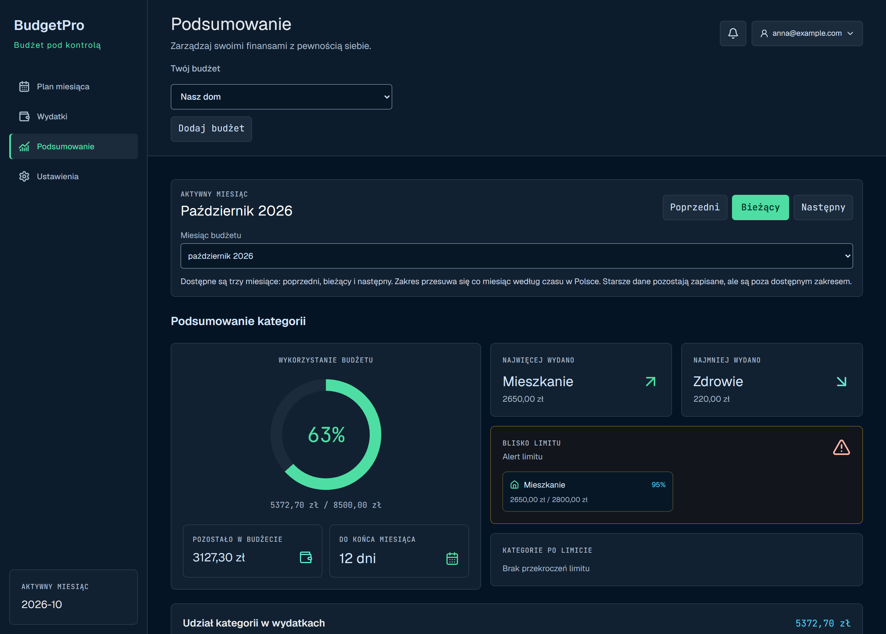
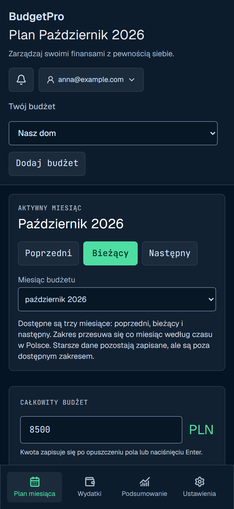
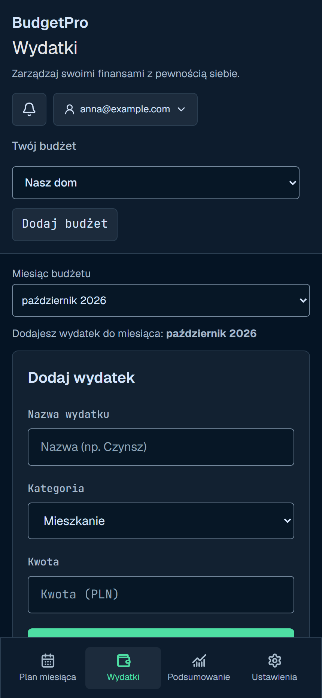
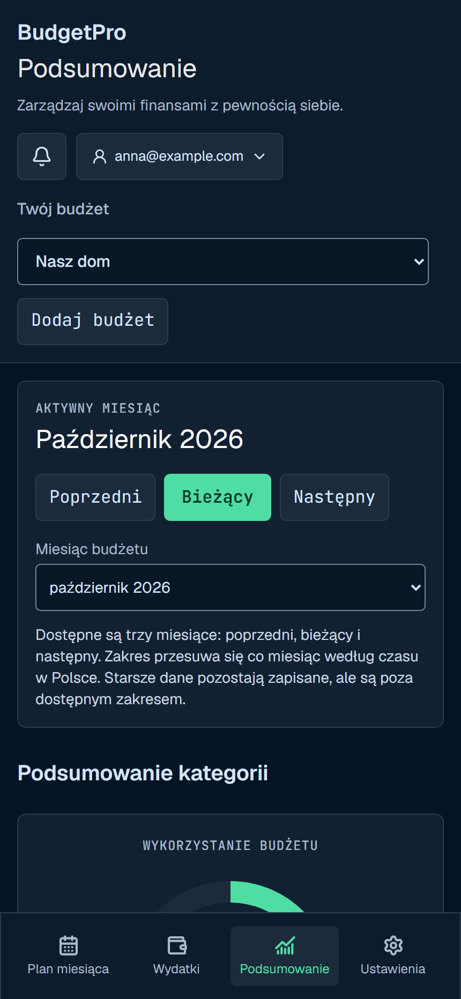

# BudgetPro — From Expense Tracking to Shared Budget Management

**A frontend and full-stack engineering case study**

BudgetPro is a responsive web application for planning monthly budgets, recording expenses, and understanding how much money remains. It also addresses the harder part of shared budgeting: deciding who can change financial data and keeping those changes consistent across users and sessions.

One account can manage several independent budgets, such as Home and Business. Each budget has its own members, roles, monthly plans, and expenses.

**Stack:** Next.js 16 · React 19 · TypeScript · Tailwind CSS 4 · Supabase Auth · PostgreSQL · Zod · React Hook Form · Recharts · Jest · Playwright

**Source code:** BudgetPro is a private project. Its source code is not shared as part of recruitment. This case study presents the product, screenshots, architecture, and engineering decisions.



*Screenshots use demonstration data and show the current Polish-language interface. This case study is written in English; a complete English product release is outside the current scope.*

## At a glance

| Area | Project scope |
| --- | --- |
| User problem | Connect a monthly spending plan with everyday expenses and shared responsibilities. |
| Core workflow | Set a month plan → record expenses → review remaining funds and category limits. |
| Frontend work | Responsive views, forms, shared calculations, async feedback, and session-aware navigation. |
| Backend work | Validated API routes, persistent budget data, budget-specific authorization, and approval workflows. |
| Main engineering challenge | Preserve the correct budget, month, author, and permissions when requests fail or users edit concurrently. |
| Quality approach | Unit and component tests, PostgreSQL integration tests, browser scenarios, and CI checks. |

## 1. The problem

A list of expenses answers “What did I spend?” It does not fully answer “How much can I still spend this month?” or “Which category needs attention?” A shared spreadsheet introduces another question: “Who is allowed to change this plan?”

BudgetPro brings those questions into one workflow. Users can define an overall monthly budget, allocate category limits, record expenses, and compare spending with their plan. When a budget is shared, membership and roles determine which actions are available.

The product is designed around three needs:

- **Clarity:** make the active budget, month, spending, and remaining amount visible.
- **Control:** keep separate budgets and their access rules independent.
- **Trust:** prevent failed saves, retries, and concurrent edits from silently changing financial records incorrectly.

These are product and engineering goals. This case study does not present user interviews or adoption statistics as evidence.

## 2. The product experience

### Plan the month

The month plan combines the overall budget with category-level limits. Users can see how much has been spent and how much remains without leaving the planning view.

The demonstration budget contains **PLN 8,500.00** in planned funds and **PLN 5,372.70** in recorded spending, leaving **PLN 3,127.30**. Housing uses approximately **95%** of its category limit even though the overall budget is only about **63%** used. Showing both levels helps users spot pressure within an otherwise healthy monthly total.

These figures illustrate the interface; they are not measured customer outcomes.

### Record and manage expenses



The expense view combines an entry form, remaining funds, and a searchable, filterable list. An expense belongs to a specific budget and month and contains a name, category, unit amount, and quantity.

Editing preserves the original author and month. Users can cancel an edit, and a failed save retains the draft so they can correct or retry it. Owners and editors can manage budget expenses; contributors can manage their own entries.

This makes error handling part of the workflow: a network failure should not force someone to reconstruct the expense they just entered.

### Understand spending



The summary shows overall budget usage, remaining funds, category distribution, and categories near or above their limits. A chart provides an overview, while amounts and category labels provide the detail needed to act.

Planning, expense entry, and the summary use a shared read model, which keeps financial calculations consistent across views.

### Use the same workflow on mobile

<table>
  <tr>
    <td align="center"></td>
    <td align="center"></td>
    <td align="center"></td>
  </tr>
  <tr>
    <td align="center">Month plan</td>
    <td align="center">Expenses</td>
    <td align="center">Summary</td>
  </tr>
</table>

Desktop layouts use a sidebar and multiple columns. Mobile layouts stack the content and provide bottom navigation for the main sections. The browser test suite includes narrow-screen expense-entry scenarios that check focus and whether the form and primary action are visible after navigation.

## 3. Architecture and responsibility boundaries

The authenticated application follows this request path:

```text
React interface
    ↓ session bearer token
Next.js Route Handler
    ↓ input validation + server-side token verification
Application service
    ↓ domain operations
Repository + user-scoped Supabase client
    ↓
PostgreSQL + Row Level Security
```

The browser renders domain data rather than raw database rows. Route handlers validate incoming data with Zod, verify the session, and delegate to services and repositories. Writes are scoped to the requested budget and month, with database policies enforcing membership and role restrictions.

This structure gives the interface a stable contract while keeping persistence and authorization rules close to the server and database.

### A budget month is a domain entity

A month is more than a date filter on an expense list. It owns its plan, currency, enabled categories, category limits, and expenses. That boundary makes it possible to change one month without implicitly changing another.

Category identifiers are stable stored keys; translated labels belong to presentation. The `other` category remains available as a fallback. A category limit of zero means no limit, which avoids treating an intentionally uncapped category as overspent.

### One read model for three views

A shared read model prepares the derived data used by the month plan, expense view, and summary. A React hook memoizes that result for the interface.

Centralizing totals and limit calculations reduces duplicated logic in components and allows those rules to be tested without rendering an entire screen. The trade-off is that aggregation currently runs on the client; larger histories could justify server-side summaries later.

## 4. Three engineering challenges

### Independent budgets without leaking access

**Problem:** A person may share a Home budget with one group and a Business budget with another. Membership in one must not grant access to the other.

**Implementation:** Each budget has an exclusive access group. The migration preserves existing budget, month, and expense identifiers while splitting older groups that contained multiple budgets. Database constraints enforce the new relationship.

**Trade-off:** Existing `household` names remain in parts of the storage layer. Keeping that compatibility reduced the scope of the migration, at the cost of legacy terminology in the implementation. The product exposes independent budgets.

### Concurrent edits without silent overwrites

**Problem:** Two owners can open the same plan. If one saves a change, the other's older form must not overwrite it unnoticed. Editor proposals also need to coexist with unrelated approved changes.

**Implementation:** Direct plan saves use a plan revision and reject stale writes. Editor proposals record changes against their original field values; approval checks those values before applying the proposal. A conflicting proposal cannot silently replace a newer value.

For example, changing the Food limit should not revert a separately updated Bills limit. The database tests exercise that distinction and verify that stale saves leave the current plan intact.

**Trade-off:** A conflict requires the user to refresh and review the current plan. This adds a recovery step, but makes concurrent changes explicit.

### Retries and destructive operations

**Problem:** A save can succeed while its response is lost. Retrying must not create a second expense. Similarly, approving a deletion and performing the deletion as separate requests can leave a partially completed operation.

**Implementation:** Expense creation uses stable identifiers so repeated submissions can resolve to one record, with author and access checks still applied. Approval and destructive deletion are handled within a database transaction, so a failure can roll back the operation.

**Trade-off:** These guarantees require database-level integration tests in addition to UI tests. A disabled button alone cannot protect against repeated or concurrent requests.

## 5. Verification strategy

| Layer | What it checks |
| --- | --- |
| Jest and React Testing Library | Domain calculations, read models, form behavior, and service boundaries. |
| PostgreSQL integration tests with PGlite | Access isolation, transaction rollback, retry behavior, approval conflicts, and plan revisions. |
| Playwright | User workflows, budget switching, session isolation, expense entry, and responsive behavior. |
| GitHub Actions | Lint, deployment-configuration checks, backup-format tests, unit/integration tests, database tests, browser tests, and build. |

The isolated browser suite intercepts Auth and API responses. It checks frontend behavior but cannot establish that live email delivery, authentication redirects, or the deployed integrations work. Those require acceptance checks in the target environment.

The project uses automated tests and CI checks at the levels described above. This case study does not report a new test run or a current coverage percentage.

## 6. Deliberate scope and trade-offs

- **An account is required.** The current application uses synchronized server data. Older browser-local reducers and migration utilities remain in the codebase, but no current route mounts that local application.
- **Three months are available in the interface.** Users can open the previous, current, and next month according to the Europe/Warsaw calendar. Older data remains stored outside that window.
- **Shared data refreshes on returning to the tab or by explicit action.** Realtime updates are outside the current release.
- **Currencies are not automatically converted.** Amounts from different currencies are not presented as directly comparable totals.
- **The public interface is Polish.** Existing English translation catalogs do not constitute a finished English release.

## 7. Outcome and next steps

BudgetPro implements a complete monthly budgeting workflow with persistent data and budget-specific collaboration. Its strongest engineering examples are the shared financial read model, independent access boundaries, explicit conflict handling, and database-backed retry and deletion safeguards.

The project demonstrates how a React interface connects to domain rules, server validation, and persistent authorization. The outcome documented here is implemented functionality and a verification strategy; user growth, savings improvements, and production performance gains have not been measured for this case study.

The most useful next steps would be to observe representative users completing the core workflow, measure task completion and error recovery, and use that evidence to prioritize changes. Longer history access, complete English localization, and more immediate shared-data updates are potential extensions that should be evaluated against actual use.

---

Prepared on **26 October 2026** using project documentation and existing demonstration screenshots. The application source code remains private.
